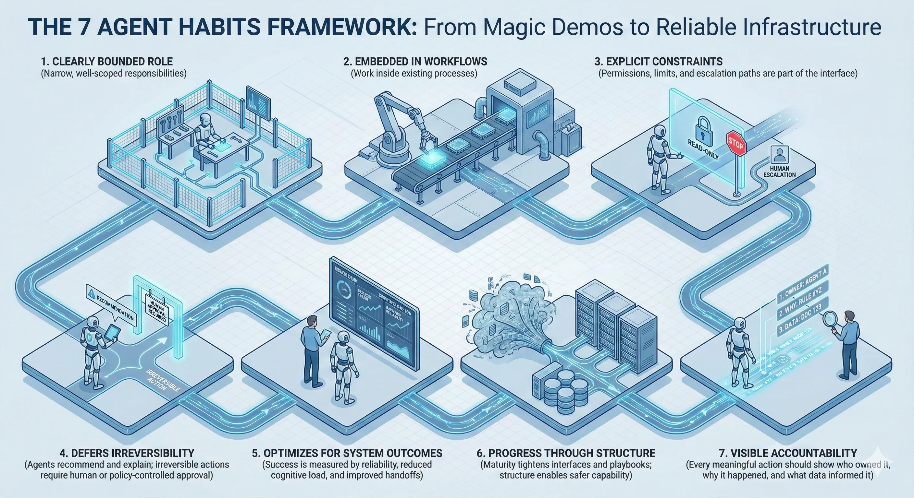

# Agentic Systems Habits

<div align="center">

[](https://opensource.org/licenses/MIT)
[](https://agent-habits.github.io/)
[](https://github.com/agent-habits/agent-habits.github.io)
[](https://agent-habits.github.io/)

**A canonical design lens and governance framework for production-grade agentic systems.**

[Explore Live Site](https://agent-habits.github.io/) • [Visual Architecture Tour](https://agent-habits.github.io/architecture/) • [Governance Philosophy](https://agent-habits.github.io/governance/) • [Get the Badge](https://agent-habits.github.io/badge/)

</div>

---

This repository defines a canonical set of habits observed in agentic systems that reliably create value in real production environments.

The goal of this project is to provide a shared language for engineers, system designers, and executive leaders to reason about where agents belong, how they should behave, and why many agentic initiatives fail despite increasingly capable models.

This is not a tutorial or an SDK for building agents. **It is a design lens.**

## Core Belief

> Effective agentic systems are not autonomous actors.
> 
> They are governed components designed to reduce ambiguity, improve decisions, and increase system reliability without replacing accountability.

This belief prioritizes system outcomes over novelty, autonomy, or raw model capability.

---

## The Seven Habits

| # | Habit | Architectural Focus | Core Intent |
| :-: | :--- | :--- | :--- |
| **01** | [**Clearly Bounded Role**](https://agent-habits.github.io/habits/habit-1/) | Scope & Blast Radius | Narrow, well-scoped responsibilities that limit uncertainty and clarify expectations. |
| **02** | [**Embedded in Workflows**](https://agent-habits.github.io/habits/habit-2/) | System Integration | Operates inside existing processes as structured steps, not end-to-end owners. |
| **03** | [**Explicit Constraints**](https://agent-habits.github.io/habits/habit-3/) | Interface Guardrails | Permissions, limits, and escalation paths are part of the interface, not prompt suggestions. |
| **04** | [**Defers Irreversibility**](https://agent-habits.github.io/habits/habit-4/) | Human-in-the-Loop | Recommends and explains; irreversible actions require human or policy approval. |
| **05** | [**Optimizes for System Outcomes**](https://agent-habits.github.io/habits/habit-5/) | Telemetry & Health | Success is measured by reliability, reduced cognitive load, and improved handoffs. |
| **06** | [**Progress Through Structure**](https://agent-habits.github.io/habits/habit-6/) | Playbooks & Scaffolding | Maturity tightens interfaces and playbooks; structure enables safer capability. |
| **07** | [**Visible Accountability**](https://agent-habits.github.io/habits/habit-7/) | Auditability & Provenance | Every meaningful action traces who owned it, why it happened, and what data informed it. |

<div align="center">
  <a href="https://agent-habits.github.io/architecture/">
    
  </a>
  <p><em>Click to explore the interactive factory tour on the documentation site.</em></p>
</div>

---

## What This Framework Is and Is Not

### What This Is
* A stable manifesto defining the philosophy behind effective agentic systems
* A canonical set of seven habits, each defined independently with intent, scope, and governance implications
* A shared vocabulary for engineers, architects, and leadership
* Real-world failure modes and architectural patterns

### What This Is Not
* **Not an SDK or framework:** No code dependencies or proprietary runtimes
* **Not a step-by-step tutorial:** Habits are structural properties, not sequential stages
* **Not a maturity scorecard:** We do not score or endorse vendors
* **Not an autonomy guarantee:** More raw model intelligence does not compensate for missing boundaries

---

## Agent Habits Badge

Projects that align with this framework may display the Agent Habits badge to signal intentional design and governance of agentic systems.

The badge represents participation in a shared vocabulary and set of design habits, not certification or compliance.

[](https://agent-habits.github.io/badge/)

```markdown
[](https://agent-habits.github.io/badge/)
```

Learn more about the badge and guidelines: <https://agent-habits.github.io/badge/>

---

## Local Development & Preview

This documentation site is built with [Astro](https://astro.build/). To preview it locally:

```bash
# 1. Install dependencies
npm install

# 2. Start local development server
npm run dev
```

Open `http://localhost:4321` in your browser. Any edits made to pages or styles update live in real time.

To build the static production distribution:
```bash
npm run build
npm run preview
```

---

## Contributing

This project is open source and intentionally curated. Contributions are welcomed in the form of:
* Real-world production examples and case studies
* Failure analyses and postmortems grounded in real systems
* Design patterns or tools that support existing habits
* Additions to the [Resources directory](https://agent-habits.github.io/resources/)
* Self-evaluation submissions using the [Self-Assessment Template](tools/self-assessment.md)

See [CONTRIBUTING.md](CONTRIBUTING.md) for details.

---

## License & Attribution

This project is licensed under the [MIT License](LICENSE).

While the license permits broad reuse, attribution is strongly encouraged when referencing or adapting this framework in writing, talks, publications, or derivative works.

**Created and Curated by:** [Inbar Rose](https://inbarrose.com)
